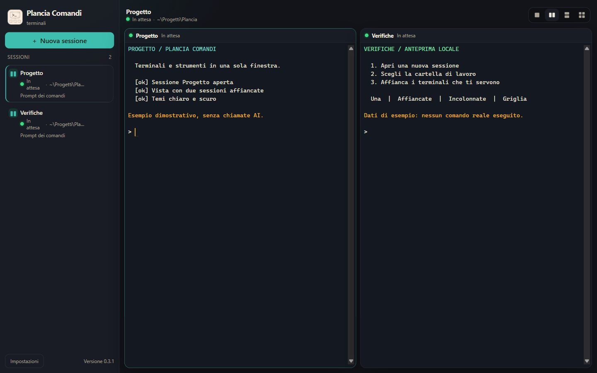
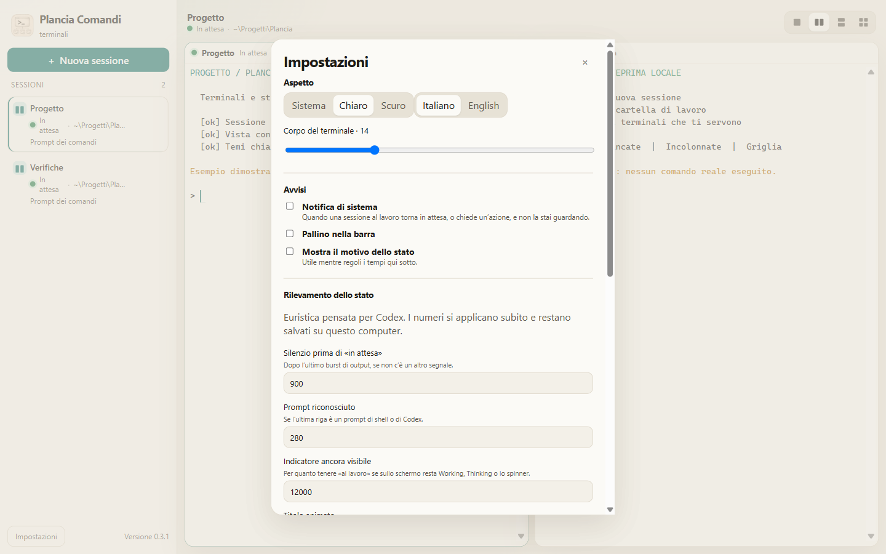

# Plancia Comandi

## Italiano

Plancia Comandi riunisce più terminali reali in una finestra desktop. Puoi lavorare con shell e CLI per programmare con l'AI, vedere quali sessioni stanno lavorando o attendono un intervento e affiancare i terminali che ti servono.

**Versione 0.2.0 · sviluppo iniziale · target macOS, Windows e Linux · Apache-2.0.** I pacchetti e il comportamento sulle singole piattaforme richiedono ancora le verifiche indicate nel [piano](PLAN.md). I tool eseguiti nei terminali si installano separatamente.



**Sommario**

- [1. Funzioni principali](#1-funzioni-principali)
- [2. Installazione e primo utilizzo](#2-installazione-e-primo-utilizzo)
- [3. Impostazioni](#3-impostazioni)
- [4. Sicurezza e privacy](#4-sicurezza-e-privacy)
- [5. Sviluppo e verifiche](#5-sviluppo-e-verifiche)
- [6. Distribuzione](#6-distribuzione)
- [7. Documentazione e licenza](#7-documentazione-e-licenza)

### 1. Funzioni principali

- Fino a 12 sessioni, con scelta della shell e della cartella iniziale.
- Viste **Una**, **Affiancate**, **Incolonnate** e **Griglia**, con icone, rinomina e chiusura delle sessioni.
- Stati **Avvio**, **Al lavoro**, **In attesa**, **Azione** e **Terminata**, stimati dall'output, dal titolo e dai processi figli.
- Pallini nella barra e notifiche di sistema per sessioni che richiedono attenzione.
- Tema di sistema, chiaro o scuro; interfaccia italiana o inglese; dimensione del testo e tempi configurabili.
- Copia, incolla, trascinamento di file e testo, collegamenti nel browser e scorciatoie adatte alla piattaforma.

Il rilevamento è euristico, pensato soprattutto per le schermate di Codex CLI: non legge lo stato interno dei programmi. Non sostituisce il controllo del terminale. La lingua iniziale è italiana; il rilevamento automatico della lingua di sistema non è ancora implementato. Le sessioni non vengono ripristinate dopo l'uscita dall'app.


### 2. Installazione e primo utilizzo

Per l'avvio dai sorgenti servono Git, Node.js con npm e gli strumenti di compilazione del modulo nativo `node-pty`. Le istruzioni complete per installarli sono nel capitolo [Installazione](ISTRUZIONI.md#2-installazione). Node.js 24 è l'ambiente usato per le verifiche locali di questa documentazione.

```bash
git clone https://github.com/gloutchov/Plancia-Comandi.git
cd Plancia-Comandi
npm ci
npm run dev
```

Il repository è privato: per il clone occorre un account autorizzato. `npm ci` scarica dipendenze ed Electron e ricompila il modulo del terminale. Si apre una finestra desktop: la pagina web di sviluppo, da sola, non può creare terminali.

1. Premi **Nuova sessione**.
2. Scegli shell e cartella, inserisci un nome facoltativo e premi **Apri**.
3. Usa il terminale come quello di sistema. Con almeno due sessioni, le icone in alto a destra scelgono **Affiancate** o **Incolonnate**; da tre sessioni è disponibile anche la **Griglia**.

Vedi il [quick start desktop](QUICK-START_Desktop.md) e il [manuale italiano](ISTRUZIONI.md).

### 3. Impostazioni

Apri **Impostazioni** per lingua, tema, corpo del terminale, avvisi e tempi del rilevamento. Le modifiche effettuate nell'interfaccia si applicano subito e restano sul computer in `settings.json`, nella cartella dati dell'app. **Apri il file di configurazione** mostra il file nel gestore dei file; dopo una modifica manuale riavvia l'app.

Il tema predefinito segue il sistema. Le impostazioni non contengono credenziali né ripristinano le sessioni. Valori mancanti o non validi ricevono i valori predefiniti o sono limitati all'intervallo ammesso. I limiti di appunti, trascinamento e lunghezza dell'input stanno in [`config/app.config.json`](config/app.config.json); dopo una modifica di quel file riavvia l'app. Vedi la [configurazione completa](ISTRUZIONI.md#6-configurazione).



### 4. Sicurezza e privacy

I comandi hanno gli stessi permessi dell'utente che avvia l'app e possono leggere o modificare file e usare la rete. L'app non integra un provider AI, non gestisce API key e non impone il consenso o i permessi dei tool avviati: autenticazione e invio dei dati dipendono da quei tool.

Le preferenze salvano anche l'ultima cartella utilizzata. L'output del terminale resta nei buffer di memoria dell'app; shell e programmi avviati possono scrivere cronologia e log propri. Notifiche, clipboard, schermate e messaggi diagnostici possono esporre informazioni. Il modello descrive [controlli implementati e limiti residui](SECURITY_MODEL.md), inclusi i controlli Electron ancora mancanti.

### 5. Sviluppo e verifiche

Stack: Electron 45, React 19, TypeScript, Vite 6, xterm.js, `@xterm/headless` e `node-pty`. La UI è in `src/`, l'accesso a PTY e sistema in `electron/`, la logica pura degli stati in `src/shared/status.ts`. Vedi [MAP.md](MAP.md) e [AGENTS.md](AGENTS.md).

```bash
npm test
npm run build
```

Vitest verifica rilevamento degli stati, burst, titoli, stabilizzazione e notifiche; non avvia Electron. La build esegue TypeScript e genera i bundle. Non esistono comandi npm dedicati a lint, typecheck o e2e. Il workflow manuale `package-windows.yml` costruisce e verifica i pacchetti Windows; non parte su push o PR. La build non verifica una shell reale o un installer.

Per una dimostrazione da un checkout con Bash, su macOS/Linux:

```bash
PLANCIA_DEMO=1 npm run dev
```

La demo apre due shell, avvia un indicatore simulato e imposta il tema scuro, salvandolo nelle preferenze correnti. Non usa un modello AI. Il manuale descrive demo, variabili di sviluppo e limiti.

### 6. Distribuzione

Eseguire prima test e build, poi creare il pacchetto sul sistema di destinazione:

```bash
npm run dist:mac
npm run dist:win
npm run dist:linux
```

Eseguire solo il comando per la piattaforma interessata. `npm run dist` usa quella corrente. `release/` riceve DMG/ZIP su macOS, installer NSIS/eseguibile portabile x64 su Windows, AppImage/DEB su Linux. `node-pty` viene ricompilato per Electron con `npm run rebuild` quando necessario.

La configurazione macOS disabilita la firma; su Windows non è configurato un certificato. Per questo progetto la distribuzione prevista è non firmata, senza notarizzazione o aggiornamento automatico configurati. Gatekeeper e SmartScreen possono mostrare avvisi. Non modificare le protezioni del sistema per aprire artifact di origine o integrità non verificate.

Prima di pubblicare una release occorrono approvazione del commit, verifiche sulla piattaforma reale, smoke fuori dal checkout e checksum SHA-256 degli artifact. La release `v0.2.0` esiste già con i sorgenti. L’integrazione dei pacchetti macOS ARM64 e Windows x64 è registrata nel piano. Per i download disponibili fanno fede gli allegati e i checksum della release. Vedi [PLAN.md](PLAN.md).

### 7. Documentazione e licenza

| Documento | Contenuto |
| --- | --- |
| [ISTRUZIONI.md](ISTRUZIONI.md) | Manuale completo in italiano. |
| [INSTRUCTIONS.md](INSTRUCTIONS.md) | Traduzione inglese completa del manuale. |
| [QUICK-START_Desktop.md](QUICK-START_Desktop.md) | Avvio rapido desktop IT/EN. |
| [SECURITY_MODEL.md](SECURITY_MODEL.md) | Sicurezza, privacy, controlli e rischi IT/EN. |
| [MAP.md](MAP.md) | Struttura e responsabilità del repository IT/EN. |
| [PLAN.md](PLAN.md) | Piano, verifiche e procedura di chiusura IT/EN. |
| [AGENTS.md](AGENTS.md) | Regole operative per agenti e maintainer. |

Licenza **Apache License 2.0**: testo completo in [LICENSE](LICENSE).

## English

Plancia Comandi brings several real terminals into one desktop window. Work with shells and AI coding CLIs, see which sessions are working or waiting for input, and tile the terminals you need.

**Version 0.2.0 · early development · macOS, Windows and Linux targets · Apache-2.0.** Packages and platform behavior still require the checks listed in the [plan](PLAN.md). Tools used inside terminals are installed separately.


**Contents**

- [1. Main features](#1-main-features)
- [2. Installation and first use](#2-installation-and-first-use)
- [3. Settings](#3-settings)
- [4. Security and privacy](#4-security-and-privacy)
- [5. Development and checks](#5-development-and-checks)
- [6. Distribution](#6-distribution)
- [7. Documentation and license](#7-documentation-and-license)

### 1. Main features

- Up to 12 sessions, with a choice of shell and starting folder.
- **One**, **Side by side**, **Stacked** and **Grid** views, with icons, plus session renaming and closing.
- **Starting**, **Working**, **Idle**, **Action** and **Exited** states estimated from output, titles and child processes.
- Sidebar dots and system notifications for sessions requiring attention.
- System, light or dark theme; Italian or English interface; configurable text size and detection timings.
- Copy, paste, file and text drag-and-drop, browser links and platform-specific shortcuts.

Detection is heuristic and mainly designed around Codex CLI screens: it does not read programs' internal state. Check the terminal itself. The initial language is Italian; automatic system-language detection is not implemented yet. Sessions are not restored after quitting the app.


### 2. Installation and first use

Running from source requires Git, Node.js with npm and build tools for the native `node-pty` module. Complete installation steps are in the [Installation](INSTRUCTIONS.md#2-installation) chapter. Node.js 24 is the environment used for this documentation's local checks.

```bash
git clone https://github.com/gloutchov/Plancia-Comandi.git
cd Plancia-Comandi
npm ci
npm run dev
```

This is a private repository: cloning requires an authorized account. `npm ci` downloads dependencies and Electron and rebuilds the terminal module. A desktop window opens: the development web page cannot create terminals on its own.

1. Click **New session**.
2. Choose a shell and folder, optionally enter a name, and click **Open**.
3. Use it like your system terminal. With at least two sessions, the icons at the top right choose **Side by side** or **Stacked**; from three sessions **Grid** is available too.

See the [desktop quick start](QUICK-START_Desktop.md) and [English manual](INSTRUCTIONS.md). To change the initial Italian interface, open **Impostazioni** and choose **English**.

### 3. Settings

Open **Settings** for language, theme, terminal size, alerts and detection timings. Interface changes apply immediately and remain on this computer in `settings.json`, in the app's data directory. **Open the configuration file** reveals the file in the file manager; restart the app after editing it manually.

The default theme follows the system. Settings do not store credentials or restore sessions. Missing or invalid values receive defaults or are clamped to their allowed range. Clipboard, drag-and-drop and input-length limits live in [`config/app.config.json`](config/app.config.json); restart the app after editing that file. See the [full configuration](INSTRUCTIONS.md#6-configuration).


### 4. Security and privacy

Commands run with the permissions of the user starting the app and can read or change files and use the network. The app has no integrated AI provider, does not manage API keys, and does not enforce consent or permissions for launched tools: those tools control authentication and data transmission.

Preferences also store the last used folder. Terminal output remains in the app's memory buffers; shells and launched programs may write their own history and logs. Notifications, clipboard, screenshots and diagnostics can expose information. The security model describes [implemented controls and remaining limitations](SECURITY_MODEL.md), including missing Electron protections.

### 5. Development and checks

Stack: Electron 45, React 19, TypeScript, Vite 6, xterm.js, `@xterm/headless` and `node-pty`. UI lives in `src/`, PTY and system access in `electron/`, and pure status logic in `src/shared/status.ts`. See [MAP.md](MAP.md) and [AGENTS.md](AGENTS.md).

```bash
npm test
npm run build
```

Vitest checks status detection, output bursts, titles, stabilization and notifications; it does not launch Electron. The build runs TypeScript and generates bundles. There are no dedicated npm lint, typecheck or e2e commands. The manual `package-windows.yml` workflow builds and checks Windows packages; pushes and PRs do not trigger it. Building does not verify a real shell or installer.

For a demo from a checkout with Bash on macOS/Linux:

```bash
PLANCIA_DEMO=1 npm run dev
```

The demo opens two shells, runs a simulated indicator and selects the dark theme, saving it to current preferences. It uses no AI model. The manual covers the demo, development variables and limitations.

### 6. Distribution

Run tests and build first, then create the package on its target OS:

```bash
npm run dist:mac
npm run dist:win
npm run dist:linux
```

Run only the command for the intended platform. `npm run dist` uses the current OS. `release/` receives DMG/ZIP on macOS, an NSIS installer/x64 portable executable on Windows, and AppImage/DEB on Linux. Rebuild `node-pty` for Electron with `npm run rebuild` when necessary.

macOS configuration disables signing; Windows has no configured certificate. Distribution for this project is expected to be unsigned, with no notarization or automatic updates configured. Gatekeeper and SmartScreen may display warnings. Do not change system protections to open artifacts whose origin or integrity has not been verified.

Publishing a release requires commit approval, checks on the real platform, smoke outside the checkout and artifact SHA-256 checksums. The source-only `v0.2.0` release already exists. The plan records the addition of macOS ARM64 and Windows x64 packages. Available downloads are identified by the release assets and checksums. See [PLAN.md](PLAN.md).

### 7. Documentation and license

| Document | Contents |
| --- | --- |
| [ISTRUZIONI.md](ISTRUZIONI.md) | Complete Italian manual. |
| [INSTRUCTIONS.md](INSTRUCTIONS.md) | Complete English translation of the manual. |
| [QUICK-START_Desktop.md](QUICK-START_Desktop.md) | IT/EN desktop quick start. |
| [SECURITY_MODEL.md](SECURITY_MODEL.md) | IT/EN security, privacy, controls and risks. |
| [MAP.md](MAP.md) | IT/EN repository structure and responsibilities. |
| [PLAN.md](PLAN.md) | IT/EN plan, checks and closure procedure. |
| [AGENTS.md](AGENTS.md) | Operating rules for agents and maintainers. |

Licensed under the **Apache License 2.0**: see the full text in [LICENSE](LICENSE).
