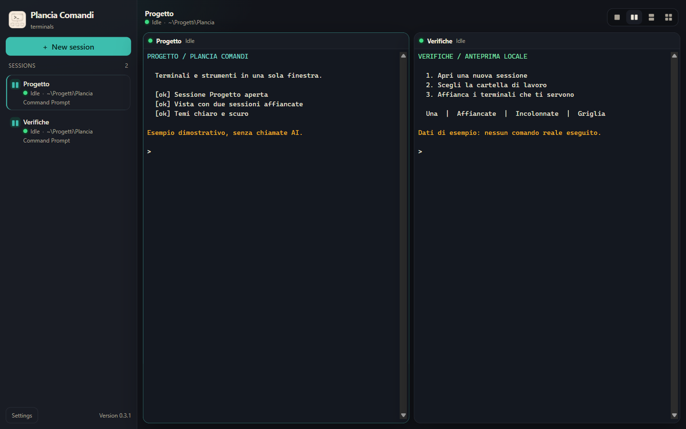
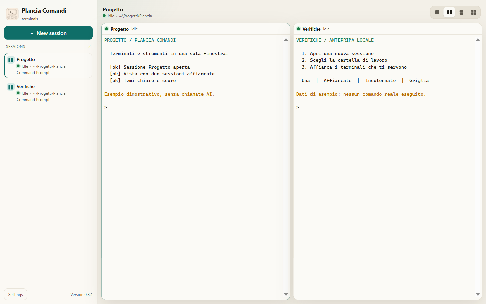
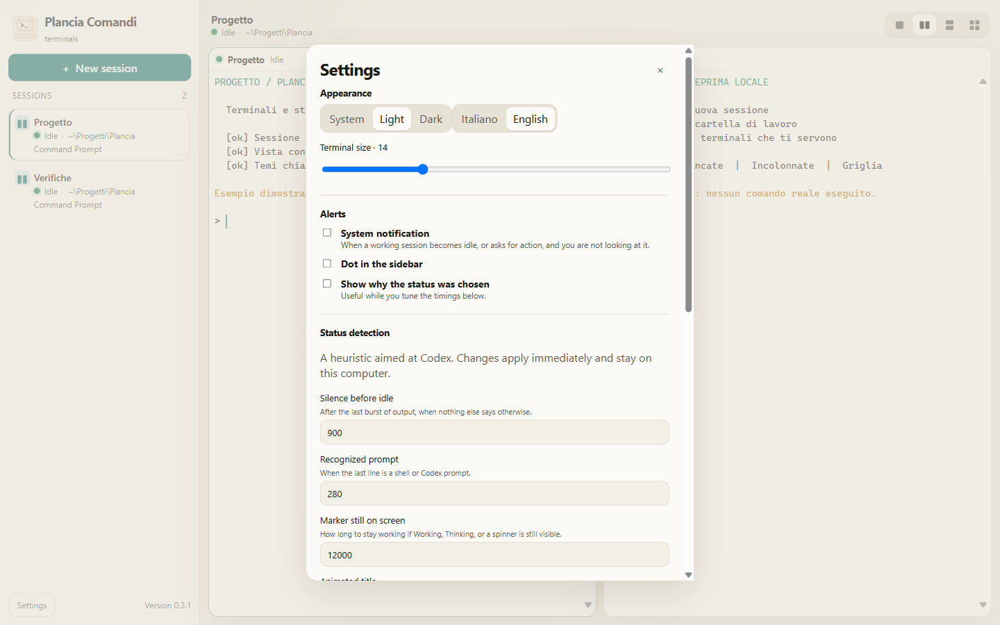

# Plancia Comandi

## Italiano

Plancia Comandi riunisce più terminali reali in una finestra desktop. Puoi lavorare con shell e CLI per programmare con l'AI, vedere quali sessioni stanno lavorando o attendono un intervento e affiancare i terminali che ti servono.

**Versione sorgenti 0.3.1 · sviluppo iniziale · target macOS, Windows e Linux · Apache-2.0.** I pacchetti e il comportamento sulle singole piattaforme richiedono ancora le verifiche indicate nel [piano](PLAN.md). I tool eseguiti nei terminali si installano separatamente.


Schermate della versione sorgenti 0.3.1 su Windows, con dati dimostrativi e preferenze isolate; [provenienza delle catture](docs/screenshots/capture.json). La release [0.3.1](https://github.com/gloutchov/Plancia-Comandi/releases/tag/v0.3.1) è disponibile con installer/portable Windows x64 e DMG/ZIP macOS ARM64 non firmati e checksum SHA-256.

**Sommario**

- [1. Funzioni principali](#1-funzioni-principali)
- [2. Installazione e primo utilizzo](#2-installazione-e-primo-utilizzo)
- [3. Impostazioni](#3-impostazioni)
- [4. Sicurezza e privacy](#4-sicurezza-e-privacy)
- [5. Sviluppo e verifiche](#5-sviluppo-e-verifiche)
- [6. Distribuzione](#6-distribuzione)
- [7. Documentazione e licenza](#7-documentazione-e-licenza)

### 1. Funzioni principali

- Fino a 12 sessioni, con scelta della shell e della cartella iniziale.
- Viste **Una**, **Affiancate**, **Incolonnate** e **Griglia**, con icone, rinomina e chiusura delle sessioni.
- Stati **Avvio**, **Al lavoro**, **In attesa**, **Azione** e **Terminata**, stimati dall'output, dal titolo e dai processi figli.
- Pallini nella barra e notifiche di sistema per sessioni che richiedono attenzione.
- Tema di sistema, chiaro o scuro; interfaccia italiana o inglese; dimensione del testo e tempi configurabili.
- Copia, incolla, trascinamento di file e testo, collegamenti nel browser e scorciatoie adatte alla piattaforma.

Il rilevamento è euristico, pensato soprattutto per le schermate di Codex CLI: non legge lo stato interno dei programmi. Non sostituisce il controllo del terminale. La lingua iniziale è italiana; il rilevamento automatico della lingua di sistema non è ancora implementato. Le sessioni non vengono ripristinate dopo l'uscita dall'app.


### 2. Installazione e primo utilizzo

Per l'avvio dai sorgenti servono Git e Node.js 22.12 o successivo con npm: è il minimo richiesto da Electron 45.2.3. Su Windows non serve compilare e non servono diritti di amministratore: `node-pty` 1.1.0 include prebuild N-API. Su macOS e Linux servono ancora gli strumenti di compilazione. Le istruzioni complete sono nel capitolo [Installazione](ISTRUZIONI.md#2-installazione). Le verifiche locali di questa documentazione usano Node.js 24.

```bash
git clone https://github.com/gloutchov/Plancia-Comandi.git
cd Plancia-Comandi
npm ci
npm run dev
```

Il repository è pubblico; per il clone in lettura non è necessario un account GitHub. `npm ci` scarica dipendenze ed Electron. Su macOS e Linux ricompila il modulo del terminale; su Windows usa la prebuild. Si apre una finestra desktop: la pagina web di sviluppo, da sola, non può creare terminali.

1. Premi **Nuova sessione**.
2. Scegli shell e cartella, inserisci un nome facoltativo e premi **Apri**.
3. Usa il terminale come quello di sistema. Con almeno due sessioni, le icone in alto a destra scelgono **Affiancate** o **Incolonnate**; da tre sessioni è disponibile anche la **Griglia**.

Vedi il [quick start desktop](QUICK-START_Desktop.md) e il [manuale italiano](ISTRUZIONI.md).

#### Compilare ed eseguire su Linux

Su Linux non è stata testata di persona.

1. Installa Git e Node.js 22.12 o successivo, con npm. È il minimo di Electron 45.2.3. I controlli descritti in questi documenti usano Node.js 24.
2. Installa gli strumenti per compilare `node-pty`. La versione 1.1.0 non ha una prebuild Linux e `npm ci` la ricompila per Electron con node-gyp. Il README di `node-pty` chiede `make`, `python` e `build-essential`. Su Debian e Ubuntu `build-essential` include già `make`, `gcc` e `g++`; il pacchetto Python da installare è `python3`.

```bash
sudo apt-get update
sudo apt-get install -y build-essential python3
```

Su un'altra distribuzione servono gli equivalenti di `build-essential` e `python3`.

3. Dalla cartella del progetto esegui installazione, test, build e avvio:

```bash
npm ci
npm test
npm run build
npm run dev
```

4. Il pacchetto Linux ha uno script: `npm run dist:linux`. Produce un AppImage e un DEB in `release/`, con nomi `PlanciaComandi-linux-<versione>-<arch>.AppImage` e `.deb`. Va eseguito dopo test e build, sul sistema Linux di destinazione. Su Linux non è stata testata di persona.

### 3. Impostazioni

Apri **Impostazioni** per lingua, tema, corpo del terminale, avvisi e tempi del rilevamento. Le modifiche effettuate nell'interfaccia si applicano subito e restano sul computer in `settings.json`, nella cartella dati dell'app. **Apri il file di configurazione** mostra il file nel gestore dei file; dopo una modifica manuale riavvia l'app.

Il tema predefinito segue il sistema. Le impostazioni non contengono credenziali né ripristinano le sessioni. Valori mancanti o non validi ricevono i valori predefiniti o sono limitati all'intervallo ammesso. I limiti di appunti, trascinamento e lunghezza dell'input stanno in [`config/app.config.json`](config/app.config.json); dopo una modifica di quel file riavvia l'app. Vedi la [configurazione completa](ISTRUZIONI.md#6-configurazione).


### 4. Sicurezza e privacy

I comandi hanno gli stessi permessi dell'utente che avvia l'app e possono leggere o modificare file e usare la rete. L'app non integra un provider AI, non gestisce API key e non impone il consenso o i permessi dei tool avviati: autenticazione e invio dei dati dipendono da quei tool.

Le preferenze salvano anche l'ultima cartella utilizzata. L'output del terminale resta nei buffer di memoria dell'app; shell e programmi avviati possono scrivere cronologia e log propri. Notifiche, clipboard, schermate e messaggi diagnostici possono esporre informazioni. La finestra non carica script da Internet. Il modello descrive [controlli implementati e limiti residui](SECURITY_MODEL.md): la shell resta con i permessi dell'utente e i pacchetti non sono firmati.

### 5. Sviluppo e verifiche

Stack: Electron 45, React 19, TypeScript, Vite 6, xterm.js, `@xterm/headless` e `node-pty`. La UI è in `src/`, l'accesso a PTY e sistema in `electron/`, la logica pura degli stati in `src/shared/status.ts`. Vedi [MAP.md](MAP.md) e [AGENTS.md](AGENTS.md).

```bash
npm test
npm run build
```

Vitest verifica rilevamento degli stati, burst, titoli, stabilizzazione, notifiche, la policy del renderer e il controllo dei messaggi IPC precedenti a M1; non avvia Electron. La build esegue TypeScript e genera i bundle. Non esistono comandi npm dedicati a lint, typecheck o e2e. Il workflow manuale `package-windows.yml` non parte su push o PR e non pubblica una release. La run `43226304320` ha costruito i pacchetti Windows di 0.3.0, tooling `49ca65d6f5ae06ea9d6d22de4dd7af2cf38b4dba`, e ha verificato l'eseguibile scompattato, il portable e l'app installata. Il workflow manuale `package-macos.yml` non parte su push o PR. La run `43257940568`, tooling `95500826ba986a4ef4addceda8840188595ee2c7`, ha costruito il DMG e lo ZIP Apple Silicon non firmati e ha eseguito smoke e ispezione solo sull'app scompattata. La release è [v0.3.0](https://github.com/gloutchov/Plancia-Comandi/releases/tag/v0.3.0). La build non verifica una shell reale o un installer.

La landing di presentazione è in [`docs/index.html`](docs/index.html), con IT/EN, tema automatico e manuale, galleria delle sei catture C3 e link pubblici ai pacchetti 0.3.1. La milestone C4 ne registra verifiche e pubblicazione. Per controllarla dal checkout:

```bash
npm run check:site
npm run preview:site
```

Apri `http://127.0.0.1:4174/Plancia-Comandi/`; Ctrl+C arresta l'anteprima. Il server serve solo la pagina statica, senza avviare Electron. La sorgente di pubblicazione prevista da C4 è `main` e `/docs`, con `.nojekyll` e i due controlli del commit prima del push; non è aggiunto un workflow al repository. GitHub esegue comunque il deploy Pages gestito, necessario per il sito richiesto. L'URL di pubblicazione è `https://gloutchov.github.io/Plancia-Comandi/`; un eventuale dominio dedicato richiede una scelta separata. Procedura: [sorgente di pubblicazione Pages](https://docs.github.com/en/pages/getting-started-with-github-pages/configuring-a-publishing-source-for-your-github-pages-site).

Per una dimostrazione da un checkout con Bash, su macOS/Linux:

```bash
PLANCIA_DEMO=1 npm run dev
```

La demo apre due shell, avvia un indicatore simulato e imposta il tema scuro, salvandolo nelle preferenze correnti. Non usa un modello AI. Il manuale descrive demo, variabili di sviluppo e limiti.

### 6. Distribuzione

Eseguire prima test e build, poi creare il pacchetto sul sistema di destinazione:

```bash
npm run dist:mac
npm run dist:win
npm run dist:linux
```

Eseguire solo il comando per la piattaforma interessata. `npm run dist` usa quella corrente. `release/` riceve DMG/ZIP su macOS, installer NSIS/eseguibile portabile x64 su Windows, AppImage/DEB su Linux. Su Windows il pacchetto usa le prebuild di `node-pty` e non ricompila. Su macOS e Linux `npm ci` ricompila il modulo per Electron; `npm run rebuild` ripete quella compilazione.

La configurazione macOS disabilita la firma; su Windows non è configurato un certificato. Per questo progetto la distribuzione prevista è non firmata, senza notarizzazione o aggiornamento automatico configurati. Il pacchetto macOS di questo workflow è solo Apple Silicon (arm64): Intel non è supportato. Gatekeeper e SmartScreen possono mostrare avvisi. Al primo avvio di un download, fai clic destro sull'app e scegli **Apri**. Non modificare le protezioni del sistema per aprire artifact di origine o integrità non verificate.

**Firma e notarizzazione non disponibili:** Glauco ha confermato il 13 novembre 2026 di non disporre dei certificati e delle credenziali necessari per la firma Windows e per la firma/notarizzazione macOS. Queste attività sono escluse dalle milestone di sicurezza M5–M9 e non ne bloccano la chiusura. I pacchetti restano non firmati; ogni release deve dichiararlo e includere SHA-256. Il checksum permette di verificare l'integrità rispetto al manifest pubblicato, ma non autentica l'editore come una firma digitale. La configurazione di firma potrà essere rivalutata solo se saranno disponibili le credenziali e una nuova richiesta esplicita. Gli interventi applicativi ancora da eseguire sono nel [piano di sicurezza](PLAN.md#21-milestone-di-sicurezza-pianificate).

Prima di pubblicare una release occorrono approvazione del commit, verifiche sulla piattaforma reale, smoke fuori dal checkout e checksum SHA-256 degli artifact. La release `v0.2.0` esiste già con i sorgenti e con i pacchetti macOS ARM64. La release [v0.3.0](https://github.com/gloutchov/Plancia-Comandi/releases/tag/v0.3.0) è pubblicata il 12 novembre 2026 sul commit `94ff1e44106f08fdcf961cab74171668112ad780`, con i pacchetti Windows della run `43226304320` e i pacchetti macOS della run `43257940568`. Le PR #6 e #7 sono unite; la PR #4 è chiusa senza merge; i branch di lavoro sono cancellati. Su Linux non è stata testata di persona. Il debito tecnico dei controlli di pacchetto è in [PLAN.md](PLAN.md). Per i download disponibili fanno fede gli allegati e i checksum della release.

### 7. Documentazione e licenza

| Documento | Contenuto |
| --- | --- |
| [ISTRUZIONI.md](ISTRUZIONI.md) | Manuale completo in italiano. |
| [INSTRUCTIONS.md](INSTRUCTIONS.md) | Traduzione inglese completa del manuale. |
| [QUICK-START_Desktop.md](QUICK-START_Desktop.md) | Avvio rapido desktop IT/EN. |
| [SECURITY_MODEL.md](SECURITY_MODEL.md) | Sicurezza, privacy, controlli e rischi IT/EN. |
| [MAP.md](MAP.md) | Struttura e responsabilità del repository IT/EN. |
| [PLAN.md](PLAN.md) | Piano, verifiche e procedura di chiusura IT/EN. |
| [AGENTS.md](AGENTS.md) | Regole operative per agenti e maintainer. |
| [docs/index.html](docs/index.html) | Sorgenti della landing IT/EN di C4. |

Licenza **Apache License 2.0**: testo completo in [LICENSE](LICENSE).

## English

Plancia Comandi brings several real terminals into one desktop window. Work with shells and AI coding CLIs, see which sessions are working or waiting for input, and tile the terminals you need.

**Source version 0.3.1 · early development · macOS, Windows and Linux targets · Apache-2.0.** Packages and platform behavior still require the checks listed in the [plan](PLAN.md). Tools used inside terminals are installed separately.



Screenshots of source version 0.3.1 on Windows, using demonstration data and isolated preferences; [capture provenance](docs/screenshots/capture.json). Release [0.3.1](https://github.com/gloutchov/Plancia-Comandi/releases/tag/v0.3.1) is available with unsigned Windows x64 installer/portable and macOS ARM64 DMG/ZIP packages and SHA-256 checksums.

**Contents**

- [1. Main features](#1-main-features)
- [2. Installation and first use](#2-installation-and-first-use)
- [3. Settings](#3-settings)
- [4. Security and privacy](#4-security-and-privacy)
- [5. Development and checks](#5-development-and-checks)
- [6. Distribution](#6-distribution)
- [7. Documentation and license](#7-documentation-and-license)

### 1. Main features

- Up to 12 sessions, with a choice of shell and starting folder.
- **One**, **Side by side**, **Stacked** and **Grid** views, with icons, plus session renaming and closing.
- **Starting**, **Working**, **Idle**, **Action** and **Exited** states estimated from output, titles and child processes.
- Sidebar dots and system notifications for sessions requiring attention.
- System, light or dark theme; Italian or English interface; configurable text size and detection timings.
- Copy, paste, file and text drag-and-drop, browser links and platform-specific shortcuts.

Detection is heuristic and mainly designed around Codex CLI screens: it does not read programs' internal state. Check the terminal itself. The initial language is Italian; automatic system-language detection is not implemented yet. Sessions are not restored after quitting the app.



### 2. Installation and first use

Running from source requires Git and Node.js 22.12 or newer with npm: that is the minimum required by Electron 45.2.3. On Windows, compiling is not required and administrator rights are not required: `node-pty` 1.1.0 includes N-API prebuilds. macOS and Linux still need build tools. Complete installation steps are in the [Installation](INSTRUCTIONS.md#2-installation) chapter. This documentation's local checks use Node.js 24.

```bash
git clone https://github.com/gloutchov/Plancia-Comandi.git
cd Plancia-Comandi
npm ci
npm run dev
```

This repository is public; read-only cloning does not require a GitHub account. `npm ci` downloads dependencies and Electron. On macOS and Linux it rebuilds the terminal module; on Windows it uses the prebuild. A desktop window opens: the development web page cannot create terminals on its own.

1. Click **New session**.
2. Choose a shell and folder, optionally enter a name, and click **Open**.
3. Use it like your system terminal. With at least two sessions, the icons at the top right choose **Side by side** or **Stacked**; from three sessions **Grid** is available too.

See the [desktop quick start](QUICK-START_Desktop.md) and [English manual](INSTRUCTIONS.md). To change the initial Italian interface, open **Impostazioni** and choose **English**.

#### Build and run on Linux

It has not been tested in person on Linux.

1. Install Git and Node.js 22.12 or newer, with npm. That is the minimum for Electron 45.2.3. The checks described in these documents use Node.js 24.
2. Install the tools that compile `node-pty`. Version 1.1.0 has no Linux prebuild, and `npm ci` rebuilds it for Electron with node-gyp. The `node-pty` README asks for `make`, `python` and `build-essential`. On Debian and Ubuntu, `build-essential` already includes `make`, `gcc` and `g++`; the Python package to install is `python3`.

```bash
sudo apt-get update
sudo apt-get install -y build-essential python3
```

On another distribution, install the equivalents of `build-essential` and `python3`.

3. From the project folder, install, test, build and start:

```bash
npm ci
npm test
npm run build
npm run dev
```

4. The Linux package has a script: `npm run dist:linux`. It produces an AppImage and a DEB in `release/`, named `PlanciaComandi-linux-<version>-<arch>.AppImage` and `.deb`. Run it after the tests and the build, on the target Linux system. It has not been tested in person on Linux.

### 3. Settings

Open **Settings** for language, theme, terminal size, alerts and detection timings. Interface changes apply immediately and remain on this computer in `settings.json`, in the app's data directory. **Open the configuration file** reveals the file in the file manager; restart the app after editing it manually.

The default theme follows the system. Settings do not store credentials or restore sessions. Missing or invalid values receive defaults or are clamped to their allowed range. Clipboard, drag-and-drop and input-length limits live in [`config/app.config.json`](config/app.config.json); restart the app after editing that file. See the [full configuration](INSTRUCTIONS.md#6-configuration).



### 4. Security and privacy

Commands run with the permissions of the user starting the app and can read or change files and use the network. The app has no integrated AI provider, does not manage API keys, and does not enforce consent or permissions for launched tools: those tools control authentication and data transmission.

Preferences also store the last used folder. Terminal output remains in the app's memory buffers; shells and launched programs may write their own history and logs. Notifications, clipboard, screenshots and diagnostics can expose information. The window does not load scripts from the Internet. The security model describes [implemented controls and remaining limitations](SECURITY_MODEL.md): the shell still runs with the user's permissions and the packages are unsigned.

### 5. Development and checks

Stack: Electron 45, React 19, TypeScript, Vite 6, xterm.js, `@xterm/headless` and `node-pty`. UI lives in `src/`, PTY and system access in `electron/`, and pure status logic in `src/shared/status.ts`. See [MAP.md](MAP.md) and [AGENTS.md](AGENTS.md).

```bash
npm test
npm run build
```

Vitest checks status detection, output bursts, titles, stabilization, notifications, the renderer policy and the checks on IPC messages that predate M1; it does not launch Electron. The build runs TypeScript and generates bundles. There are no dedicated npm lint, typecheck or e2e commands. The manual `package-windows.yml` workflow does not run on push or PR and does not publish a release. Run `43226304320` built the Windows packages for 0.3.0, tooling `49ca65d6f5ae06ea9d6d22de4dd7af2cf38b4dba`, and checked the unpacked executable, the portable executable and the installed app. The manual `package-macos.yml` workflow does not run on push or PR. Run `43257940568`, tooling `95500826ba986a4ef4addceda8840188595ee2c7`, built the unsigned Apple Silicon DMG and ZIP and ran smoke tests and inspection only on the unpacked app. The release is [v0.3.0](https://github.com/gloutchov/Plancia-Comandi/releases/tag/v0.3.0). Building does not verify a real shell or installer.

The presentation landing page is in [`docs/index.html`](docs/index.html), with IT/EN, automatic and manual theme, the six C3 screenshots and public links to the 0.3.1 packages. Milestone C4 records its checks and publication. To check it from the checkout:

```bash
npm run check:site
npm run preview:site
```

Open `http://127.0.0.1:4174/Plancia-Comandi/`; Ctrl+C stops the preview. The server serves only the static page and does not launch Electron. The planned publishing source is `main` and `/docs`, with `.nojekyll`, with both commit reviews before pushing; no repository workflow is added. GitHub still runs its managed Pages deployment, which is necessary for the requested site. The publication URL is `https://gloutchov.github.io/Plancia-Comandi/`; a dedicated domain requires a separate choice. Procedure: [Pages publishing source](https://docs.github.com/en/pages/getting-started-with-github-pages/configuring-a-publishing-source-for-your-github-pages-site).

For a demo from a checkout with Bash on macOS/Linux:

```bash
PLANCIA_DEMO=1 npm run dev
```

The demo opens two shells, runs a simulated indicator and selects the dark theme, saving it to current preferences. It uses no AI model. The manual covers the demo, development variables and limitations.

### 6. Distribution

Run tests and build first, then create the package on its target OS:

```bash
npm run dist:mac
npm run dist:win
npm run dist:linux
```

Run only the command for the intended platform. `npm run dist` uses the current OS. `release/` receives DMG/ZIP on macOS, an NSIS installer/x64 portable executable on Windows, and AppImage/DEB on Linux. On Windows the package uses the `node-pty` prebuilds and does not compile. On macOS and Linux `npm ci` rebuilds the module for Electron; `npm run rebuild` repeats that compilation.

macOS configuration disables signing; Windows has no configured certificate. Distribution for this project is expected to be unsigned, with no notarization or automatic updates configured. The macOS package from this workflow is Apple Silicon (arm64) only: Intel is not supported. Gatekeeper and SmartScreen may display warnings. The first time you open a download, right-click the app and choose **Open**. Do not change system protections to open artifacts whose origin or integrity has not been verified.

**Signing and notarization unavailable:** on 13 November 2026 Glauco confirmed that the certificates and credentials required for Windows signing and macOS signing/notarization are unavailable. These activities are excluded from security milestones M5–M9 and do not block their closure. Packages remain unsigned; every release must disclose this and include SHA-256. The checksum verifies integrity against the published manifest but does not authenticate the publisher as a digital signature does. Signing configuration may be reconsidered only when credentials are available and a new explicit request is made. Application work still to be carried out is listed in the [security plan](PLAN.md#21-planned-security-milestones).

Publishing a release requires commit approval, checks on the real platform, smoke outside the checkout and artifact SHA-256 checksums. The `v0.2.0` release already exists with the sources and the macOS ARM64 packages. Release [v0.3.0](https://github.com/gloutchov/Plancia-Comandi/releases/tag/v0.3.0) was published on 12 November 2026 at commit `94ff1e44106f08fdcf961cab74171668112ad780`, with the Windows packages from run `43226304320` and the macOS packages from run `43257940568`. PRs #6 and #7 are merged; PR #4 is closed without a merge; the work branches are deleted. It has not been tested in person on Linux. Packaging-check debt is in [PLAN.md](PLAN.md). Available downloads are identified by the release assets and checksums.

### 7. Documentation and license

| Document | Contents |
| --- | --- |
| [ISTRUZIONI.md](ISTRUZIONI.md) | Complete Italian manual. |
| [INSTRUCTIONS.md](INSTRUCTIONS.md) | Complete English translation of the manual. |
| [QUICK-START_Desktop.md](QUICK-START_Desktop.md) | IT/EN desktop quick start. |
| [SECURITY_MODEL.md](SECURITY_MODEL.md) | IT/EN security, privacy, controls and risks. |
| [MAP.md](MAP.md) | IT/EN repository structure and responsibilities. |
| [PLAN.md](PLAN.md) | IT/EN plan, checks and closure procedure. |
| [AGENTS.md](AGENTS.md) | Operating rules for agents and maintainers. |
| [docs/index.html](docs/index.html) | C4 IT/EN landing source. |

Licensed under the **Apache License 2.0**: see the full text in [LICENSE](LICENSE).
