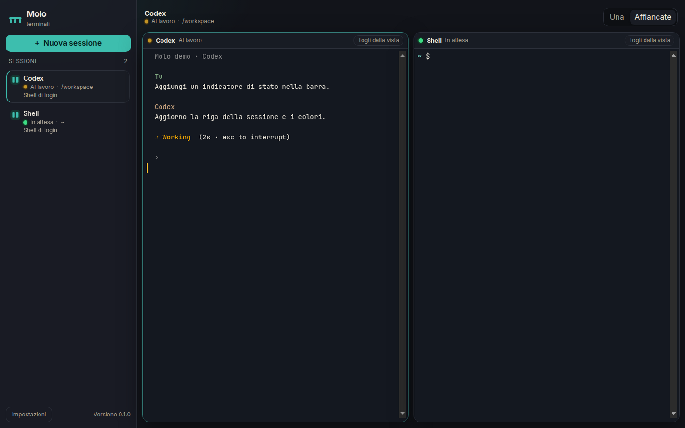

# Molo

Molo is a desktop app for keeping several real terminals open at once. It is meant for AI coding CLIs, especially the OpenAI Codex CLI: a sidebar shows every session and whether it is working or waiting, and the main area can show one terminal or several side by side.

The interface is in Italian by default. English is in Settings.



## Stack

- Electron 45 and electron-builder
- React 19 and Vite 6
- [xterm.js](https://xtermjs.org/) 5.5 for the visible terminal, plus the fit and web-links addons
- `@xterm/headless` in the main process, so status detection sees the screen Codex actually draws
- [node-pty](https://github.com/microsoft/node-pty) 1.1 for a real PTY (ConPTY on Windows, Unix ptys elsewhere)

`npm install` rebuilds `node-pty` for Electron's Node version (`electron-builder install-app-deps`).

## Run it

```bash
npm install
npm test
npm run dev
```

`npm run dev` starts Vite and opens the Electron window. The renderer is also served at <http://127.0.0.1:47231/>. That page cannot spawn terminals: the PTY lives in the Electron main process. Use the window.

A session starts in your home directory. On macOS and Linux the default shell is your login shell (`$SHELL`, or `/bin/zsh` / `/bin/bash`) started with `-l`, so a GUI launch still picks up Homebrew, nvm, and similar profile setup. On Windows the default is Windows PowerShell (`powershell.exe -NoLogo`). PowerShell 7, Command Prompt, and Git Bash are offered when they are installed.

## Try the status lights without Codex

```bash
MOLO_DEMO=1 npm run dev
```

That opens two sessions: one runs `scripts/demo-codex.sh busy` (a full-screen spinner and a `Working` title, like Codex), and one is a normal shell. The script also accepts `attention` and `idle`:

```bash
scripts/demo-codex.sh attention
```

## Layout

- **Una** shows the session you click.
- **Affiancate** shows every session you pin. The pin is the columns icon on the row. Ctrl-click (Command-click on macOS) toggles it too.
- The focused tile is the one that receives the keyboard.
- Closing a session that is working, or that needs you, asks first.

Copy and paste follow the platform: Command-C / Command-V on macOS, Ctrl-Shift-C / Ctrl-Shift-V on Windows and Linux. A right-click copies the selection, or pastes when nothing is selected.

## How status detection works

Each session is one of five phases:

| Phase | Meaning |
| --- | --- |
| Avvio | The process has not printed anything yet. |
| Al lavoro | Codex or the shell is producing output or still running a command. |
| In attesa | It is quiet and waiting for you. |
| Azione | Codex (or the screen) is asking for a decision. |
| Terminata | The process exited. |

The rules live in `src/shared/status.ts` and are covered by `src/shared/status.test.ts`. The main process only feeds them facts: timestamps, the parsed screen, the window title, and whether the shell has a live child. Nothing in the detector touches a PTY, so the thresholds can be changed without guessing.

Codex is the case the rules are written for. While a turn runs, its window title cycles a Braille spinner about every 100 ms and the screen shows `Working` and `esc to interrupt`. When it needs you (an approval, a question), the title becomes `Action required`. When it is sitting in the composer, the redraws stop.

The decision, in order:

1. A dead process is **terminated**.
2. No output yet, inside the startup grace, is **starting**. After that, **idle**.
3. A fresh title or the bottom of the screen matching “action required”, “waiting for approval”, or “do you want to proceed” is **action**. This wins over a spinner, because you are the blocker.
4. A title that still says working, or still contains the spinner, is **busy**. A title that stops changing is ignored after `titleBusyMaxMs` (3 s). Codex animates the spinner the whole time it works, so a frozen “Working” does not stick forever. That also limits the known stale-footer bug in Codex.
5. `Working`, `Thinking`, `esc to interrupt`, or a spinner still on the last lines of the screen keeps the session **busy** for `busyMarkerQuietMs` (12 s) after real output pauses.
6. A recognized prompt on the last non-empty line (`›`, `❯`, `PS C:\…>`, `user@host path $`, a bare `%`) becomes **idle** after `promptIdleTimeoutMs` (280 ms), unless a busy marker is still holding.
7. A burst of output is **busy** until `quietTimeoutMs` (900 ms) of silence. One echoed keystroke is not a burst. A chunk of at least `burstBytes` (16), or `burstCount` chunks inside `burstWindowMs`, is.
8. On a normal screen, a child process with no prompt stays **busy** for `childQuietTimeoutMs` (8 s). That covers `sleep`, a quiet compiler, and similar commands. A full-screen TUI such as Codex is an alternate screen and ignores this rule: Codex stays running while it waits for you, so a live child must not mean “working”.
9. Otherwise the session is **idle**.

An action-required state is held for `attentionHoldMs` (1.8 s) so a blinking title does not flicker the badge.

### Alerts

When a session leaves **working** and you are not looking at it, Molo can show a sidebar dot and a system notification. A short command (under `minBusyForNotifyMs`, 1.6 s) does not notify on the way back to idle. **Action required** always notifies, even if the busy stretch was short. Nothing notifies for the first prompt when a shell starts, and nothing notifies for the session you are already watching.

Both switches are in Settings. Timings apply immediately and are saved in Electron's user-data folder (`settings.json`). Use **Apri il file di configurazione** to reveal it. Extra regexes go in that file:

```json
{
  "status": {
    "quietTimeoutMs": 900,
    "extraIdlePatterns": ["^ready>"],
    "extraBusyPatterns": ["compiling"],
    "extraAttentionPatterns": ["allow this edit"]
  }
}
```

A broken regex is ignored. Numbers are clamped to a safe range. **Ripristina i tempi** puts the built-in timings back. **Mostra il motivo dello stato** prints the rule that fired (`title-busy`, `idle-prompt`, `active-child`, …) under each session.

### Limits

- This is a heuristic. It does not read Codex's internal state.
- Apps that keep redrawing while they wait (htop, a clock in the prompt, a spinner that never stops) stay **working**. That matches “producing output”.
- A TUI that waits for you without an “action required” title, and without a prompt Molo recognizes, becomes **idle** about a second after the redraws stop. If the word `Working` is still on screen, that wait is up to 12 seconds.
- The child-process signal is only for the normal screen. It asks `ps` on macOS and Linux, and PowerShell CIM on Windows, about every 2.5 seconds. A process that exits in between polls can be a moment late.
- Prompt detection looks at the last non-empty line. A command whose last line happens to look like a shell prompt can be marked idle early.
- `100%` is not treated as a zsh prompt. Other odd last lines can still be.
- The window-title signal depends on Codex keeping the OSC title updated. If a build stops doing that, the screen markers and the silence timer are the fallback.
- System notifications need the OS to allow them. On Linux that means a working notification daemon. The sidebar dot does not.

## Tests

```bash
npm test
```

Vitest runs the detector, the output-burst tracker, the title parser, the attention hold, and the notification rules. It does not launch Electron.

## Package

Build the web and Electron bundles first, then package on the OS you are shipping:

```bash
npm run build
npm run dist:mac    # on macOS: dmg and zip
npm run dist:win    # on Windows: NSIS installer and a portable exe
npm run dist:linux  # AppImage and deb
```

`npm run dist` packages for the current OS. Output goes to `release/`.

`node-pty` is a native addon. `postinstall` rebuilds it for the local Electron. If you switch Electron versions, run `npm run rebuild`. The builder unpacks `node-pty` and `@xterm/headless` from the asar, because the `.node` binary and the pty helper cannot be loaded from inside an archive.

macOS packaging is set with `"identity": null`, so a local build is unsigned and Gatekeeper will warn. To sign and notarize, remove that field and provide an Apple Developer certificate (`CSC_NAME` or the usual `CSC_*` variables). Windows signing is not configured; set `CSC_LINK` / `CSC_KEY_PASSWORD` when you have a certificate.

Icons are generated from `build/icon.png`. electron-builder turns that into `.icns` and `.ico` during the platform build.

## What still needs a real Mac or Windows machine

This repo was developed on Linux. The PTY, the split view, both themes, and the busy/idle lights were exercised here with the demo script. These pieces were not run on macOS or Windows:

- Spawning the login shell from a Finder / Dock launch, and Windows PowerShell, Command Prompt, and Git Bash.
- Whether `-l` loads the PATH you expect for a globally installed `codex`.
- ConPTY resizing, color, and mouse input under Windows Terminal's console host.
- The real Codex TUI: confirm the title still says `Working` / `Action required`, and adjust the regexes in `settings.json` if a release changes the words.
- System notifications and the click-to-focus behavior.
- IME input, and the macOS traffic-light spacing in the sidebar.
- Keyboard shortcuts (Command on macOS, Ctrl-Shift on Windows).
- A signed installer. `npm run dist:mac` and `npm run dist:win` have not been produced from this environment.

Linux DBus warnings in the dev log are harmless when no notification bus is available. Codex itself is not bundled; install it in the shell you open inside Molo.
